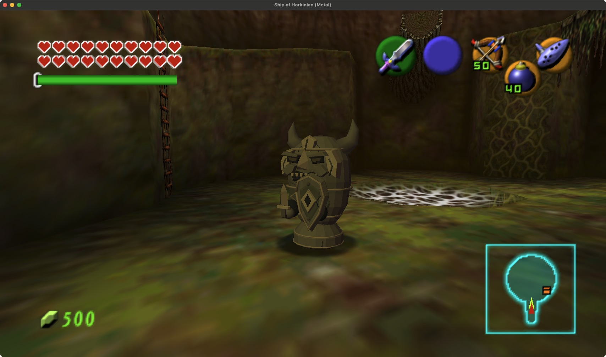

# Native Armos upgrade

The original horned stone idol now has a carved face, recessed eyes, worn beveled edges, stone teeth, an inset buckler and a short chiseled sword. Its four original visible limbs keep the body, rocking base and independent weapon arms attached to their native rig. Both enemy guards and passive pushable statues share the new geometry.

The original three-hop attack, recovery pause, return to home, awakening shake, stun counters and explosive panic remain authoritative. The model follows the full native awakening blend continuously; this value controls material color, never opacity. Native lighting, fog, damage filters and a subtle original stone texture remain active. The sword hitbox still comes from the original root callback. Passive statues retain dynamic collision and pushing.

## Assets

- `armos.blend`: editable meshes and all three native animation clips, totaling 52 frames.
- `armos.glb`: source geometry in original rigid limb spaces.
- `ArmosBlenderData.h`: compiled integer geometry, 7,213 triangles.
- `armos-studio.png` and three animation stills: authoring previews.
- `animation-validation.json`: finite posed geometry and bounds across every native frame.

Native reference geometry is extracted only for bounds and pose comparison. The runtime uses the authored GLB. The new geometry has no skin bridges: body, base, sword arm and shield arm retain their original rigid joints.

## Rebuild

From the repository root, with Blender installed:

```sh
python3 art/arpg/armos/extract_native_rig.py
blender --background --factory-startup --python art/arpg/armos/author_blender.py
python3 art/arpg/armos/export_runtime.py
blender --background --factory-startup --python art/arpg/armos/package_blend.py
python3 art/arpg/armos/validate_animation.py
blender --background --factory-startup --python art/arpg/armos/preview_motion.py
```

Extraction reads the local `build-cmake/soh/oot.o2r` archive. Blender authoring and packaging run in separate background processes and do not change a live user project. Pose validation measures the authored envelope; it does not establish watertight topology or collision coverage for every surface detail.

## Practice

Open **More → Settings & testing → Testing shortcuts → Upgraded Armos**. Choose **Awakening guard** or **Pushable statue** and summon on open, level ground in an uncleared room. The placement helper checks the floor, footprint, headroom, line of sight and nearby actors. The four-actor cap counts guards and passive statues together.

Strike a sleeping guard to awaken it. Bait the three-hop attack and use its recovery; a stun allows light-weapon follow-ups. Retreat during its final spinning panic. Passive statues remain pushable scenery.

## Integration scope

The runtime caches rigid geometry and builds only short per-frame material wrappers. Each actor can have its own awakening color without changing another actor's cached mesh. The ARPG and remastered-enemy gates restore original geometry, as does distance beyond 1,500 units. The native destructor now destroys the enemy-only attack quad; passive statues do not own that collider. Existing centralized skeleton cleanup still owns unregistering embedded animation tables.

## Verification

The final model passes 36 portable suites, geometry AddressSanitizer/UndefinedBehaviorSanitizer and 62 native integration checks. The native run records 743 draw frames, all three attacking hops, 14 observed awakening values, 47 ice frames, 150 panic frames and three explosive defeats with one reward each. The native sword quad and passive dynamic collision remain active. Ordinary menu guard summon, awakening, targeting, attack knockback and journal reopening were also checked.

The native fixture supplies collision/damage and statue push inputs, shortens the pursuit timer for home-return coverage and selects a nonlethal stun expiry branch. Full manual defeat, natural player-driven statue pushing, original switch puzzles, broad terrain and crowd performance remain acceptance work. Exact sources and scope are recorded in `tests/arpg/armos-verification-macos.json`. Your normal player save is unchanged.


