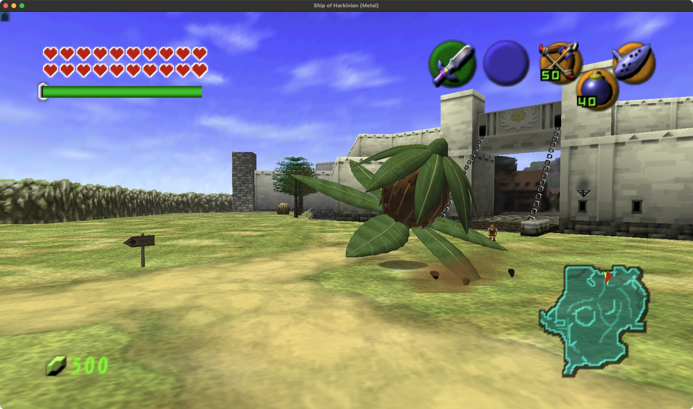

# Native Peahat upgrade

The original adult and larva now use an authored fibrous bulb, pointed husk scales, layered crown leaves and six thin, veined rotor blades. Adults have a separate amber root fitted to the original weak-point sphere. Larvae retain their smaller, flattened native proportions and a lighter leaf palette.

The new meshes follow the original rigid skeleton. Takeoff, hover, pursuit, return, landing, recoil and squash remain controlled by the native actor. The hidden rotor joint still spins the blades; the original draw callbacks still update blade-tip dust, the attack quad, root collision and targeting. Native lighting, fog and damage filters shade the new anatomy. A small amount of original bark/wing texture adds surface variation.

## Assets and rebuild

- `peahats.blend`: editable meshes, native rig and all four clips, totaling 129 frames.
- `peahats.glb`: authored source geometry in native joint spaces.
- `PeahatBlenderData.h`: compiled integer geometry; 10,652 triangles per adult and 9,648 per larva.
- `peahats-studio.png` and four animation stills: authoring previews.
- `animation-validation.json`: full animation bounds plus 48 rotor/squash samples.

From the repository root:

```sh
python3 art/arpg/peahats/extract_native_rig.py
blender --background --factory-startup --python art/arpg/peahats/author_blender.py
python3 art/arpg/peahats/export_runtime.py
blender --background --factory-startup --python art/arpg/peahats/package_blend.py
python3 art/arpg/peahats/validate_animation.py
blender --background --factory-startup --python art/arpg/peahats/preview_motion.py
```

Extraction reads the local `build-cmake/soh/oot.o2r` archive for rig and reference bounds. Native reference triangles are not used in the replacement geometry. Authoring and packaging run in separate background Blender processes without changing a live user project. Bounds validation does not establish watertight topology or collision coverage for every surface detail.

## Practice and combat

Open **More → Settings & testing → Testing shortcuts → Upgraded Peahats**. Choose a hunting adult, brood parent or larva. Summon on broad open ground such as Hyrule Field. Placement checks the floor, footprint, headroom, line of sight and nearby enemies. The limit counts four adults or ten larvae within 2,000 units; distant original field inhabitants do not block practice.

Adults protect their bulb and blades; attack the exposed root. Boomerangs stop the rotor, while the hookshot retains its native lethal root counter. Larvae pursue independently and recoil when reflected by a shield. The brood parent retains its high flight and three-child limit. Night rest and native hit responses are preserved.

## Integration

Cached rigid meshes replace eight visible limbs. The adult root is a separate native post-limb draw, not a new skeleton joint. Both feature switches and the 1,500-unit distance fallback restore original geometry.

Living children are counted when spawning, so ground/flight transitions cannot reset the three-larva cap. Every larva detaches safely when its parent is removed, continuing native pursuit. Parent references are resolved against live actors before use. The destructor now releases the attack quad, and shield reflection clears the attack flags that produced the recoil.

## Verification

The final model passes 37 portable suites, geometry AddressSanitizer/UndefinedBehaviorSanitizer and 88 native integration checks. The run records 812 draw frames, 430 rotor values, 79 stun frames, 17 larva recoil frames and five one-time defeats. Ordinary adult and larva summons, adult pursuit/root targeting/knockback, night rest and journal reopening were also checked. Your normal save is unchanged.

See `tests/arpg/peahat-verification-macos.json` for the final build, test evidence, exact source hashes and acceptance limits. Runtime fixtures use an isolated debug save and supply collision effects to native handlers. Full natural fights, broad terrain coverage and crowded-scene performance require separate acceptance testing.


