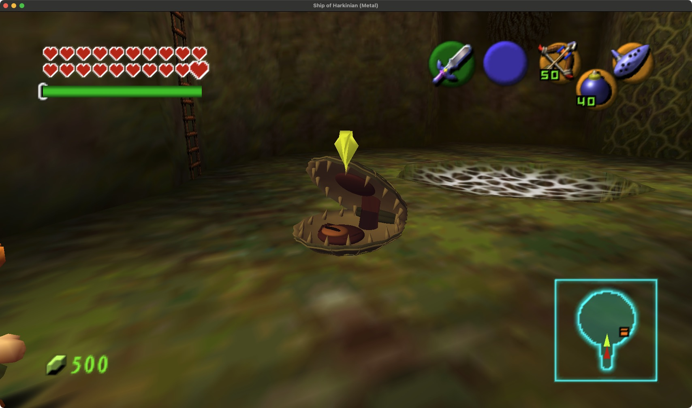

# Native Shell Blade upgrade

The original Shell Blade now has two concave, ribbed shell valves, staggered ivory teeth, a recessed inner body and an articulated adductor muscle. The valves close around the inner anatomy and remain separate rigid meshes for the original death fragments. A subtle blend of the original shell texture preserves the game's material character under native lights and fog.

The native opening warning, frontal mouth vulnerability, turn, lunge, three repeat bounces, recoil and underwater movement remain authoritative. The original nine-joint rig, four visible limbs, five clips and 42 animation frames are retained. Both ARPG feature gates and the 1,500-unit distance fallback restore original meshes.

## Assets

- `shellblades.blend`: editable meshes and native animation, packaged in an isolated Blender process.
- `shellblades.glb`: joint-local source geometry and hinge connection metadata.
- `ShellbladeBlenderData.h` in the ARPG source directory: checked integer geometry, 13,216 triangles.
- `shellblades-studio.png` and five clip stills: authoring previews.
- `animation-validation.json`: checks all 42 native poses and 1,512 quantized connection endpoints.

The lower valve is limb 4, the upper valve limb 6, the articulated inner tissue limb 7, and the lower inner body limb 8. Only the two rigid valves enter native BodyBreak. Their display lists do not borrow another joint's matrix.

## Rebuild

From the repository root:

```sh
python3 art/arpg/shellblades/extract_native_rig.py
blender --background --factory-startup --python art/arpg/shellblades/author_blender.py
python3 art/arpg/shellblades/export_runtime.py
blender --background --factory-startup --python art/arpg/shellblades/package_blend.py
blender --background --factory-startup --python art/arpg/shellblades/preview_motion.py
python3 art/arpg/shellblades/validate_animation.py
```

Extraction reads the local `build-cmake/soh/oot.o2r` archive. Authoring runs in a separate background Blender process and does not change a live user project. The validator measures posed bounds and connection endpoints; it does not assert watertight topology.

## Practice

Open **More → Settings & testing → Testing shortcuts → Upgraded Shell Blades**. Choose **On land** or **Under water** and summon. Placement checks clear floor or deep water, sightlines, nearby enemies and a six-actor cap. Approach to bait the opening; ordinary hits need the native frontal mouth window. Fire retains its original shell-bypassing damage rule.

## Native integration

The flex renderer's post callback receives original display lists, so the fragment callback explicitly captures the matching replacement valves. Interrupted successful fragment allocations now release their three owned buffers. The original fire countdown now advances every draw, allowing its alternating flame emissions and the damage filter to finish.

Native QA uses an isolated debug save, pinned player/camera, injected damage and hit positions, and selected setup calls for repeatable water and vulnerability checks. The interrupted allocation check calls the real destructor once and suppresses its second automatic call. Normal land approach and the complete four-hop sequence run through the original state machine. Full dungeon, varied terrain, natural underwater combat and crowded-scene performance remain broader acceptance work.

## Verification

The full portable run passes 35 suites. The final geometry passes its affected CTest plus AddressSanitizer/UndefinedBehaviorSanitizer. Final native QA passes 63 checks, including four land lunges, six replacement shell fragments (two underwater), three defeats, and fire/filter expiry. Ordinary menu summon, targeting, lunge and journal reopening were observed before the final adductor endpoint fitting; final geometry was then rebuilt and checked through native QA and the close-up below. The normal player save checksum is unchanged.

See `tests/arpg/shellblade-verification-macos.json` for fixture limits and exact source hashes.


